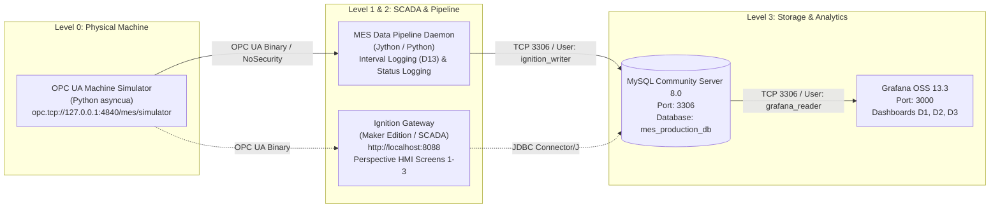

# SYSTEM ARCHITECTURE — MES Real-Time Production Monitoring System

## 1. High-Level Architecture Diagram

## 2. Component Descriptions

### 2.1 Machine Simulator (Level 0)
- Purpose-built asynchronous OPC UA server (`simulator/mes_simulator.py`) exposing the 7 standard tags under `ns=2;s=Machine01.<TagName>`.
- Generates realistic machine cycles (~5.0s ideal cycle time) with probabilistic quality split (96–98% good, 2–4% reject), stochastic temperature drift, and fault injection hooks (`control.json`).

### 2.2 Data Acquisition & Pipeline (Level 1/2)
- Implements event-driven status tracking (`machine_status_log`) with gapless interval closing upon state transitions (RUN=1, STOP=0, IDLE=2, COMM_LOSS=-1).
- Implements periodic snapshot logging (`production_log`) at configurable intervals (default 5s, Decision D13) with in-memory retry buffer on database disconnection.
- Pre-staged for Ignition Designer import via `ignition/tags.json` and `ignition/gateway_scripts/`.

### 2.3 Production Database (Level 3 - Storage)
- MySQL Community Edition 8.0 configured with InnoDB engine, utf8mb4 encoding, strict foreign key constraints, and unique indexes.
- Includes reporting views:
  - `v_current_shift`
  - `v_status_durations_by_shift`
  - `v_production_by_shift` (reset-aware delta computation, Decision D6)
  - `v_hourly_production`
  - `v_kpi_by_shift` (division-by-zero protected Availability, Performance, Quality, OEE, Achievement)
  - `v_data_quality_issues`

### 2.4 Visualization & Dashboarding (Level 3 - Presentation)
- **Grafana OSS 13.3:** Real-time production overview, machine state timeline, and OEE analytics dashboards connected via read-only user `grafana_reader`.
- **Ignition Perspective:** Browser-native HMI screens for operator monitoring, technical telemetry, and historical production query filters.
