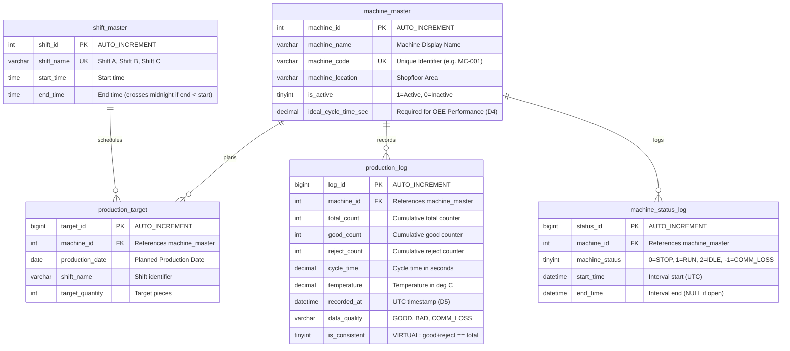

# DATABASE SCHEMA SPECIFICATION — `mes_production_db`

The database design implements the five core tables specified in TRD §6, plus additive-only columns and views required by Decision **D4** (ideal cycle time, data quality flag, consistent count virtual column, COMM_LOSS status -1, and unique targets).

## Entity-Relationship Diagram

## Reporting Views

| View Name | Primary Function |
|---|---|
| `v_current_shift` | Determines the active shift for any timestamp considering plant timezone (`+05:30`) and midnight-crossing shifts. |
| `v_status_durations_by_shift` | Aggregates duration in seconds spent in RUN, STOP, IDLE, and COMM_LOSS per shift. |
| `v_production_by_shift` | Computes delta production quantities per shift using window functions (`LAG()`) with reset detection (D6). |
| `v_hourly_production` | Groups delta production into hourly buckets for time-series trend analysis. |
| `v_kpi_by_shift` | Calculates Availability, Performance, Quality, OEE, and Production Achievement with division-by-zero protection. |
| `v_data_quality_issues` | Surfaces inconsistent counter rows (`good + reject != total`) and overlapping intervals. |
